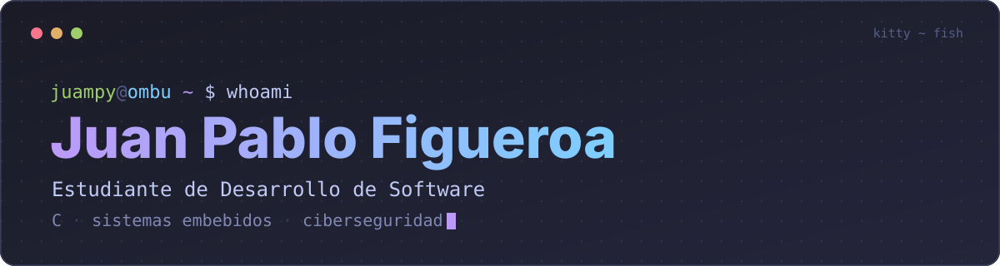

<p align="center">
  
</p>

<p align="center">
  
  
  
</p>

## Sobre mí

Curso **Desarrollo de Software en la Universidad Provincial de Ezeiza (UPE)**. Quiero entender cómo funcionan las cosas por debajo (memoria, punteros, syscalls, el sistema operativo y los circuitos) para especializarme en **ciberseguridad** y sistemas de bajo nivel: cómo el software controla el hardware y cómo se rompen y se protegen los dispositivos.

Construyo con asistencia de IA y estudio lo que construyo: lo que domino hoy es **C**; el resto lo estoy aprendiendo.

```c
typedef struct {
    const char *nombre;
    const char *estudio;
    const char *domino;
    const char *aprendiendo[4];
    const char *objetivo;
} Perfil;

const Perfil juampy = {
    .nombre      = "Juan Pablo Figueroa",
    .estudio     = "Desarrollo de Software @ UPE",
    .domino      = "C",
    .aprendiendo = { "C++", "Python", "Rust", "Arduino" },
    .objetivo    = "firmware y seguridad de hardware",
};
```

- 🔭 **Ahora:** construyendo **Plaxia**, mi SaaS médico multi-inquilino.
- 🌱 **Estudiando:** C a fondo, sistemas operativos, testing, seguridad (heap/stack, buffer overflows, autenticación).
- 🛠️ **Uso a diario:** CachyOS + Hyprland, Zed y Kitty.

## Proyectos

<table>
  <tr>
    <td width="50%" valign="top">
      <h3>🖥️ <a href="https://github.com/Jmpyy/OMBU">OMBU</a></h3>
      Mi escritorio para <strong>Hyprland</strong> hecho con Quickshell (QML): barra, launcher, notificaciones, bloqueo de pantalla, greeter y un modo foco para estudiar.<br><br>
      <sub><b>Hecho con</b> QML, Lua y Shell, con asistencia de IA.</sub>
    </td>
    <td width="50%" valign="top">
      <h3>📺 <a href="https://github.com/Jmpyy/quincho">Quincho</a></h3>
      Launcher minimalista para Android TV: APK de 67 KB, cero dependencias y ~35 MB de RAM, pensado para una tele de 1 GB. Sin publicidad.<br><br>
      <sub><b>Hecho con</b> Kotlin, con asistencia de IA.</sub>
    </td>
  </tr>
  <tr>
    <td width="50%" valign="top">
      <h3>🚀 Plaxia <sub>(privado)</sub></h3>
      SaaS para la gestión de consultorios: historias clínicas, turnos y facturación. Ya en producción con un cliente real.<br><br>
      <sub><b>Desarrollo</b> con asistencia de IA.</sub>
    </td>
    <td width="50%" valign="top">
      <h3>🚚 Rutabit</h3>
      <a href="https://github.com/Jmpyy/rutabit-monitoreo">Monitoreo</a> · <a href="https://github.com/Jmpyy/Rutabit-landing-page">Landing</a><br><br>
      Plataforma de logística y seguimiento vehicular, con una customización del core de Traccar para visualizar GPS en tiempo real.<br><br>
      <sub><b>Desarrollo</b> con asistencia de IA.</sub>
    </td>
  </tr>
</table>

También: mi [portafolio](https://github.com/Jmpyy/Jmpyy.github.io).

## Stack

<div align="center">

**Trabajando con**<br>


<br>**En el camino**<br>


</div>

## Estadísticas

<p align="center">
  <a href="https://github.com/Jmpyy">
    
  </a>
  <a href="https://github.com/Jmpyy">
    
  </a>
</p>

## Contacto

<div align="center">

<a href="mailto:jp.figueroa98@gmail.com"></a>
<a href="https://linkedin.com/in/uanpablofigueroa/"></a>
<a href="https://discordapp.com/users/juampyy_."></a>

</div>
